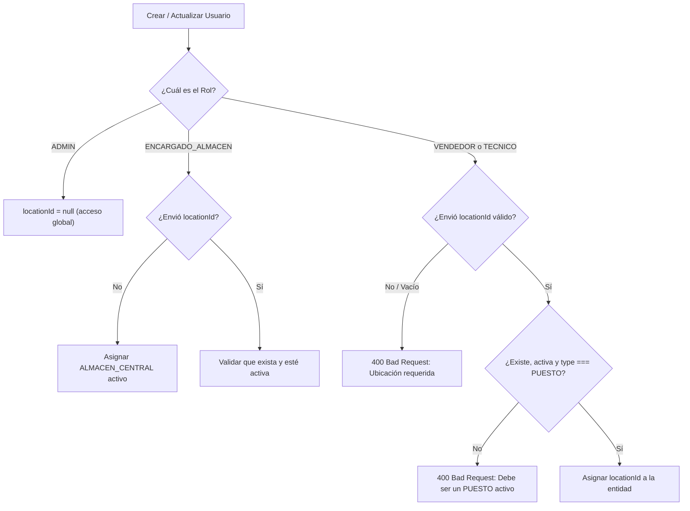
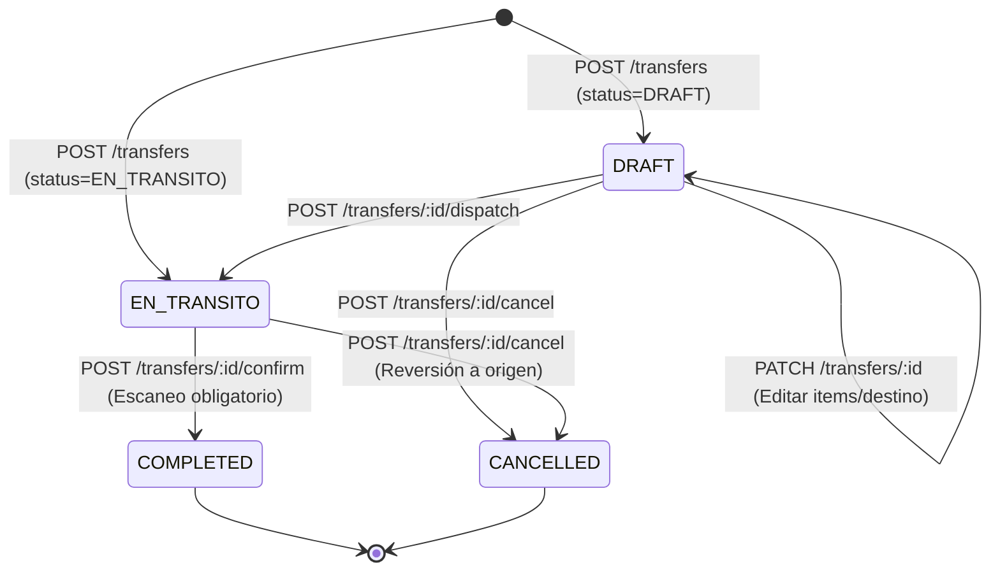

# Plan Técnico — Fase 2: Asignación de Puestos a Usuarios y Módulo de Logística Interna (M3)

## 1. Resumen y Objetivos de la Fase 2

La Fase 2 implementa la trazabilidad física del personal asignado a puntos de venta y el módulo completo de **Logística Interna y Movimientos de Inventario (M3)** bajo la Arquitectura Monolito Modular Hexagonal definida en la [CONSTITUTION.md](file:///c:/Users/bianc/Mundo-Portatil/backend-api/specs/CONSTITUTION.md).

### Objetivos Clave:
1. **Asignación de Ubicación a Usuarios (`User.locationId`):**
   - Permitir al `ADMIN` asignar una ubicación física (`Location`) al personal en `POST /users` y `PATCH /users/:id`.
   - Validar reglas estrictas por rol: `ADMIN` no tiene puesto (`null`); `ENCARGADO_ALMACEN` se vincula por defecto a `ALMACEN_CENTRAL`; `VENDEDOR` y `TECNICO` requieren obligatoriamente un puesto activo de tipo `PUESTO`.
   - Propagar `locationId` y `locationName` en el token JWT (`req.user`), en `POST /auth/login` y en `GET /auth/me` (y su alias `GET /auth/profile`).
2. **Flujo A — Traslado Directo (`Almacén Central <-> Puesto`):**
   - Movimiento inmediato `COMPLETED` sin etapa de confirmación intermedia para abastecimiento desde almacén o devolución de mercadería.
   - Restricción de ámbito para `VENDEDOR`/`TECNICO`: solo pueden trasladar entre Almacén Central y exactamente su puesto asignado.
3. **Flujo B — Transferencias entre Puestos (`Puesto Origen -> Puesto Destino`):**
   - Ciclo de vida completo: `DRAFT` (borrador editable sin bloqueo de stock) $\rightarrow$ `EN_TRANSITO` (bloqueo de series en `EN_TRANSITO` y descuento cuantitativo en origen) $\rightarrow$ `COMPLETED` (confirmación en destino con validación obligatoria y estricta de `scannedSerials`) o `CANCELLED` (reversión automática de stock al origen).
4. **Garantía Transaccional e Integración de Hoja de Vida (M6):**
   - Ejecución atómica mediante `TransactionManagerPort.runInTransaction` propagando el contexto `tx` hacia `HardwareItemRepository` y `QuantityStockRepository`.
   - Integración con `AuditLogPort` incluyendo `serials` y `hardwareItemIds` en los payloads para que los traslados se reflejen automáticamente en la Hoja de Vida de cada equipo (`GET /hardware-items/:id/lifecycle`).

---

## 2. Auditoría del Estado Actual y Archivos Afectados

### 2.1. Base de Datos (`prisma/schema.prisma`)
- `enum ItemStatus`: Actualmente tiene `EN_STOCK`, `VENDIDO`, `SEGUNDA_MANO_PENDIENTE`, `EN_GARANTIA`, `DE_BAJA`. Se debe agregar `EN_TRANSITO`.
- `enum TransferStatus`: Actualmente tiene `DRAFT`, `PENDING`, `COMPLETED`, `CANCELLED`. Se debe alinear a `DRAFT`, `EN_TRANSITO`, `COMPLETED`, `CANCELLED`.
- `enum TransferType`: Nuevo enum con valores `DIRECTO`, `ENTRE_PUESTOS`.
- `model User`:
  - Agregar `locationId String?` con `@relation(fields: [locationId], references: [id])`.
  - Reemplazar relaciones `transfersSent` y `transfersRecv` hacia el nuevo modelo `InternalTransfer`.
- `model Location`:
  - Agregar relación inversa `users User[]`.
  - Reemplazar relaciones `sourceTransfers` y `targetTransfers` hacia `InternalTransfer`.
- Reemplazar modelos placeholder no utilizados `TransferRequest` y `TransferItem` por los modelos definitivos de Fase 2: `InternalTransfer` y `InternalTransferItem`.

### 2.2. Módulo de Usuarios (`src/modules/users/`)
- `domain/entities/user.entity.ts`:
  - Agregar propiedades `locationId: string | null` y `locationName: string | null = null`.
  - Actualizar `create(...)` y `sanitize()`.
- `domain/ports/out/user-repository.port.ts`:
  - Asegurar soporte de `locationId` en consultas y mutaciones.
- `application/dto/create-user-command.dto.ts` y `update-user-command.dto.ts`:
  - Agregar `locationId?: string | null`.
- `application/dto/user-response.dto.ts`:
  - Agregar `locationId: string | null` y `locationName: string | null`.
- `application/use-cases/create-user.use-case.ts`:
  - Inyectar `LOCATION_REPOSITORY` (`LocationRepositoryPort`).
  - Implementar validación de puesto según rol (`ADMIN` $\rightarrow$ `null`; `ENCARGADO_ALMACEN` $\rightarrow$ auto `ALMACEN_CENTRAL`; `VENDEDOR`/`TECNICO` $\rightarrow$ obligatorio `PUESTO` activo).
- `application/use-cases/update-user.use-case.ts`:
  - Inyectar `LOCATION_REPOSITORY`.
  - Implementar validación de puesto según rol resultante de la actualización.
- `infrastructure/adapters/out/persistence/user.mapper.ts`:
  - Mapear `locationId` y `location?.name` en `toDomain`, `toPersistenceCreate` y `toPersistenceUpdate`.
- `infrastructure/adapters/out/persistence/prisma-user.repository.ts`:
  - Incluir `location: true` en `findUnique` y `findMany`.
- `infrastructure/adapters/in/http/dto/create-user.http-dto.ts` y `update-user.http-dto.ts`:
  - Decoradores `@ApiPropertyOptional()` y `@IsUUID('4')` para `locationId`.

### 2.3. Módulo de Autenticación (`src/modules/auth/`)
- `domain/ports/out/token-service.port.ts`:
  - Agregar `locationId: string | null` y `locationName?: string | null` a la interfaz `JwtPayload`.
- `application/dto/auth-response.dto.ts`:
  - Agregar `locationId` y `locationName` al objeto anidado `user`.
- `application/use-cases/login.use-case.ts`:
  - Pasar `locationId` y `locationName` a `tokenService.generateToken(...)` y en la respuesta HTTP.
- `application/use-cases/get-profile.use-case.ts`:
  - Retornar `locationId` y `locationName` en `UserProfileDto`.
- `infrastructure/adapters/in/http/strategies/jwt.strategy.ts`:
  - Inyectar `locationId` y `locationName` en `validate(payload)` para que queden disponibles en `req.user`.
- `infrastructure/adapters/in/http/auth.controller.ts`:
  - Exponer endpoint `GET /auth/me` con documentación Swagger completa (manteniendo `GET /auth/profile` como alias compatible).

### 2.4. Módulo de Hardware Items (`src/modules/hardware-items/`)
- `domain/entities/hardware-item.entity.ts`:
  - Agregar `'EN_TRANSITO'` a `ItemStatusType`.
  - Agregar métodos de dominio: `dispatchTransfer()`, `confirmTransfer(newLocationId: string)`, `cancelTransfer()`, `transferDirect(newLocationId: string)`.

### 2.5. Nuevo Módulo de Logística (`src/modules/transfers/`)
- Módulo completamente nuevo estructurado en `domain/`, `application/` e `infrastructure/`.

---

## 3. Diseño del Modelo de Datos (`prisma/schema.prisma`)

```prisma
// ==========================================
// ENUMS GLOBALES
// ==========================================

enum ItemStatus {
  EN_STOCK
  VENDIDO
  SEGUNDA_MANO_PENDIENTE
  EN_GARANTIA
  DE_BAJA
  EN_TRANSITO // Nuevo en Fase 2: bloqueado temporalmente durante traslado entre puestos
}

enum TransferType {
  DIRECTO
  ENTRE_PUESTOS
}

enum TransferStatus {
  DRAFT
  EN_TRANSITO
  COMPLETED
  CANCELLED
}

// ==========================================
// USUARIOS Y UBICACIONES (ACTUALIZACIÓN)
// ==========================================

model User {
  id                   String                     @id @default(uuid())
  email                String                     @unique
  name                 String
  password             String
  role                 Role                       @default(VENDEDOR)
  active               Boolean                    @default(true)
  locationId           String?                    // Asignación física (obligatorio en VENDEDOR y TECNICO)
  createdAt            DateTime                   @default(now())
  updatedAt            DateTime                   @updatedAt

  location             Location?                  @relation(fields: [locationId], references: [id])
  transfersCreated     InternalTransfer[]         @relation("TransferCreator")
  transfersReceived    InternalTransfer[]         @relation("TransferReceiver")
  cashClosings         CashClosing[]
  auditLogs            AuditLog[]
  ordersTech           TechnicalServiceOrder[]
  passThroughRequested PassThroughApprovalQueue[] @relation("PassThroughRequester")
  passThroughReviewed  PassThroughApprovalQueue[] @relation("PassThroughReviewer")

  @@map("users")
}

model Location {
  id              String             @id @default(uuid())
  name            String             // Ej: "Almacén Central", "Puesto 102"
  type            LocationType       @default(PUESTO)
  active          Boolean            @default(true)
  createdAt       DateTime           @default(now())

  users           User[]
  items           HardwareItem[]
  quantityStocks  QuantityStock[]
  transfersFrom   InternalTransfer[] @relation("TransferSource")
  transfersTo     InternalTransfer[] @relation("TransferTarget")
  cashClosings    CashClosing[]
  audits          AuditSession[]

  @@map("locations")
}

// ==========================================
// M3: LOGÍSTICA INTERNA Y TRANSFERENCIAS
// ==========================================

model InternalTransfer {
  id             String                 @id @default(uuid())
  code           String                 @unique // TR-XXXXXX
  type           TransferType
  status         TransferStatus         @default(DRAFT)
  fromLocationId String
  toLocationId   String
  createdById    String
  receivedById   String?
  notes          String?
  cancelReason   String?
  dispatchedAt   DateTime?
  receivedAt     DateTime?
  createdAt      DateTime               @default(now())
  updatedAt      DateTime               @updatedAt

  fromLocation   Location               @relation("TransferSource", fields: [fromLocationId], references: [id])
  toLocation     Location               @relation("TransferTarget", fields: [toLocationId], references: [id])
  createdByUser  User                   @relation("TransferCreator", fields: [createdById], references: [id])
  receivedByUser User?                  @relation("TransferReceiver", fields: [receivedById], references: [id])
  items          InternalTransferItem[]

  @@map("internal_transfers")
}

model InternalTransferItem {
  id             String           @id @default(uuid())
  transferId     String
  catalogId      String
  hardwareItemId String?          // Presente si es unidad serializada
  quantity       Int              @default(1) // 1 para serializados; N para productos por cantidad

  transfer       InternalTransfer @relation(fields: [transferId], references: [id], onDelete: Cascade)
  catalog        ProductCatalog   @relation(fields: [catalogId], references: [id])
  hardwareItem   HardwareItem?    @relation(fields: [hardwareItemId], references: [id])

  @@map("internal_transfer_items")
}
```

---

## 4. Arquitectura Hexagonal del Módulo `src/modules/transfers/`

```
src/modules/transfers/
├── domain/
│   ├── entities/
│   │   ├── internal-transfer.entity.ts       # Entidad raíz con invariantes y transiciones de estado
│   │   └── internal-transfer-item.entity.ts  # Entidad hija para ítems de transferencia
│   └── ports/
│       └── out/
│           ├── transfer-repository.port.ts   # Contrato de persistencia y filtros
│           └── transfer-code-generator.port.ts # Contrato de generación de códigos TR-XXXXXX
├── application/
│   ├── dto/
│   │   ├── create-direct-transfer-command.dto.ts
│   │   ├── create-transfer-command.dto.ts
│   │   ├── update-draft-transfer-command.dto.ts
│   │   ├── confirm-transfer-command.dto.ts
│   │   ├── cancel-transfer-command.dto.ts
│   │   ├── transfer-response.dto.ts
│   │   └── transfer-detail-response.dto.ts
│   └── use-cases/
│       ├── create-direct-transfer.use-case.ts # POST /transfers/direct
│       ├── create-transfer.use-case.ts        # POST /transfers (DRAFT o directo EN_TRANSITO)
│       ├── update-draft-transfer.use-case.ts  # PATCH /transfers/:id (solo DRAFT)
│       ├── dispatch-transfer.use-case.ts      # POST /transfers/:id/dispatch (DRAFT -> EN_TRANSITO)
│       ├── confirm-transfer.use-case.ts       # POST /transfers/:id/confirm (EN_TRANSITO -> COMPLETED)
│       ├── cancel-transfer.use-case.ts        # POST /transfers/:id/cancel
│       ├── get-transfers.use-case.ts          # GET /transfers
│       └── get-transfer-detail.use-case.ts    # GET /transfers/:id
├── infrastructure/
│   ├── adapters/
│   │   ├── in/
│   │   │   └── http/
│   │   │       ├── dto/
│   │   │       │   ├── create-direct-transfer.http-dto.ts
│   │   │       │   ├── create-transfer.http-dto.ts
│   │   │       │   ├── update-draft-transfer.http-dto.ts
│   │   │       │   ├── confirm-transfer.http-dto.ts
│   │   │       │   ├── cancel-transfer.http-dto.ts
│   │   │       │   └── query-transfers.http-dto.ts
│   │   │       └── transfers.controller.ts   # Rutas HTTP, Swagger y Guards RBAC
│   │   └── out/
│   │       ├── persistence/
│   │       │   ├── transfer.mapper.ts
│   │       │   └── prisma-transfer.repository.ts
│   │       └── generator/
│   │           └── crypto-transfer-code-generator.adapter.ts
│   └── transfers.module.ts
```

---

## 5. Lógica de Dominio y Flujos Operativos

### 5.1. Validación de Asignación de Ubicación en Usuarios



### 5.2. Flujo A — Traslado Directo (`POST /transfers/direct`)
- **Propósito:** Abastecimiento rápido desde el Almacén Central hacia un puesto, o retorno de mercadería desde un puesto hacia el Almacén Central.
- **Validación de Roles:**
  - `ADMIN` y `ENCARGADO_ALMACEN`: pueden ejecutar traslados entre `ALMACEN_CENTRAL` y cualquier `PUESTO`.
  - `VENDEDOR` y `TECNICO`: uno de los extremos debe ser `ALMACEN_CENTRAL` y el otro debe ser **exactamente su puesto asignado** (`req.user.locationId`). Caso contrario: `403 Forbidden`.
- **Transacción Atómica (`TransactionManagerPort.runInTransaction`):**
  1. Genera código `TR-XXXXXX`.
  2. Valida ítems serializados: verifica que cada serie exista, pertenezca al catálogo, esté en `fromLocationId` y tenga `status === 'EN_STOCK'`. Actualiza `locationId = toLocationId` manteniendo `status = 'EN_STOCK'`.
  3. Valida ítems cuantitativos: verifica que haya saldo suficiente en `fromLocationId` (`QuantityStock.quantity >= requestedQuantity`). Descuenta en origen y suma (upsert) en destino.
  4. Crea `InternalTransfer` en estado `COMPLETED` con `dispatchedAt = now()`, `receivedAt = now()`, `receivedById = req.user.id`.
  5. Inserta `InternalTransferItem[]`.
  6. Registra `TRANSFER_DIRECT_COMPLETED` en `AuditLogPort` con `serials` y `hardwareItemIds`.

### 5.3. Flujo B — Transferencias entre Puestos



#### Transiciones y Reglas de Negocio:
1. **Creación (`POST /transfers`):**
   - Si el rol es `VENDEDOR` o `TECNICO`: `fromLocationId` se fija automáticamente como `req.user.locationId` (rechaza con `403` si intenta enviar desde otro puesto).
   - Si `status === 'DRAFT'`: Solo guarda el registro y sus ítems sin alterar inventario.
   - Si `status === 'EN_TRANSITO'`: Ejecuta el bloqueo y despacho de inmediato en transacción.
2. **Edición (`PATCH /transfers/:id`):**
   - Solo permitido en estado `DRAFT`. Reemplaza ítems y destino.
3. **Despacho (`POST /transfers/:id/dispatch`):**
   - Solo permitido en estado `DRAFT`.
   - Dentro de transacción:
     - Series: pasan de `EN_STOCK` a `EN_TRANSITO` (siguen en `fromLocationId` pero bloqueadas).
     - Cuantitativo: se descuenta de `QuantityStock` en `fromLocationId`.
     - Actualiza transferencia a `EN_TRANSITO` y `dispatchedAt = now()`.
   - Registra en bitácora `TRANSFER_DISPATCHED`.
4. **Confirmación de Recepción (`POST /transfers/:id/confirm`):**
   - Solo permitido en estado `EN_TRANSITO`.
   - **Autorización de receptor:** `req.user.locationId === transfer.toLocationId` (o `ADMIN` / `ENCARGADO_ALMACEN`). Vendedores de otros puestos reciben `403 Forbidden`.
   - **Validación de Escaneo (`scannedSerials`):**
     - Se comparan las series escaneadas contra las series esperadas en `transfer.items`.
     - Si hay faltantes o sobrantes, se rechaza con `400 Bad Request` indicando detalladamente el error.
   - Dentro de transacción:
     - Series: pasan de `EN_TRANSITO` a `EN_STOCK` y su `locationId` se actualiza a `toLocationId`.
     - Cuantitativo: se incrementa en `toLocationId` mediante upsert en `QuantityStock`.
     - Transferencia: pasa a `COMPLETED`, `receivedById = req.user.id`, `receivedAt = now()`.
   - Registra en bitácora `TRANSFER_CONFIRMED`.
5. **Cancelación (`POST /transfers/:id/cancel`):**
   - Permitido en `DRAFT` o `EN_TRANSITO`.
   - Si estaba `EN_TRANSITO`:
     - Series: regresan de `EN_TRANSITO` a `EN_STOCK` en `fromLocationId`.
     - Cuantitativo: se re-acredita en `fromLocationId`.
   - Pasa a `CANCELLED`, almacena `cancelReason`.
   - Registra en bitácora `TRANSFER_CANCELLED`.

---

## 6. Matriz de Control de Acceso (RBAC)

| Endpoint | ADMIN | ENCARGADO_ALMACEN | VENDEDOR | TECNICO | Restricción de Alcance |
| :--- | :---: | :---: | :---: | :---: | :--- |
| `POST /users` (asigna locationId) | ✅ | ❌ | ❌ | ❌ | Solo Admin puede crear usuarios con puesto |
| `PATCH /users/:id` (reasigna puesto) | ✅ | ❌ | ❌ | ❌ | Solo Admin puede modificar puestos de personal |
| `GET /auth/me` / `GET /auth/profile` | ✅ | ✅ | ✅ | ✅ | Retorna `locationId` y `locationName` del usuario |
| `POST /transfers/direct` | ✅ | ✅ | ✅ | ✅ | Vendedor/Técnico restringido a su propio puesto |
| `POST /transfers` | ✅ | ✅ | ✅ | ✅ | Vendedor/Técnico: `fromLocationId = user.locationId` |
| `PATCH /transfers/:id` | ✅ | ✅ | ✅ | ✅ | Solo en `DRAFT`, por creador o emisor |
| `POST /transfers/:id/dispatch` | ✅ | ✅ | ✅ | ✅ | Solo en `DRAFT`, por creador o emisor |
| `POST /transfers/:id/confirm` | ✅ | ✅ | ✅ | ✅ | Solo en `EN_TRANSITO`, por receptor en `toLocationId` |
| `POST /transfers/:id/cancel` | ✅ | ✅ | ✅ | ✅ | Solo en `DRAFT` o `EN_TRANSITO`, emisor o receptor |
| `GET /transfers` | ✅ | ✅ | ✅ | ✅ | Vendedor/Técnico auto-filtrado a su puesto |
| `GET /transfers/:id` | ✅ | ✅ | ✅ | ✅ | Vendedor/Técnico restringido a sus traslados |

---

## 7. Verificación, Pruebas y Actualización de Contratos

1. **Pruebas Unitarias y de Integración:**
   - Pruebas de asignación de puestos y validación por rol en `Users`.
   - Pruebas del guard JWT y propagación en `req.user`.
   - Pruebas de traslados directos (`COMPLETED` atómico).
   - Pruebas del ciclo `DRAFT` $\rightarrow$ `EN_TRANSITO` $\rightarrow$ `COMPLETED` con validación estricta de escaneo de series.
   - Pruebas de cancelación y reversión de inventario.
2. **Pureza Arquitectónica:**
   - Cero dependencias de infraestructura en `domain/` y `application/`.
3. **Compilación Estricta:**
   - `npm run build` con **0 errores**.
4. **Contratos Oficiales:**
   - Actualización de [specs/API_CONTRACTS.md](file:///c:/Users/bianc/Mundo-Portatil/backend-api/specs/API_CONTRACTS.md) documentando `locationId` en `/users` y todos los nuevos endpoints de `/transfers` con ejemplos JSON completos de petición y respuesta.
